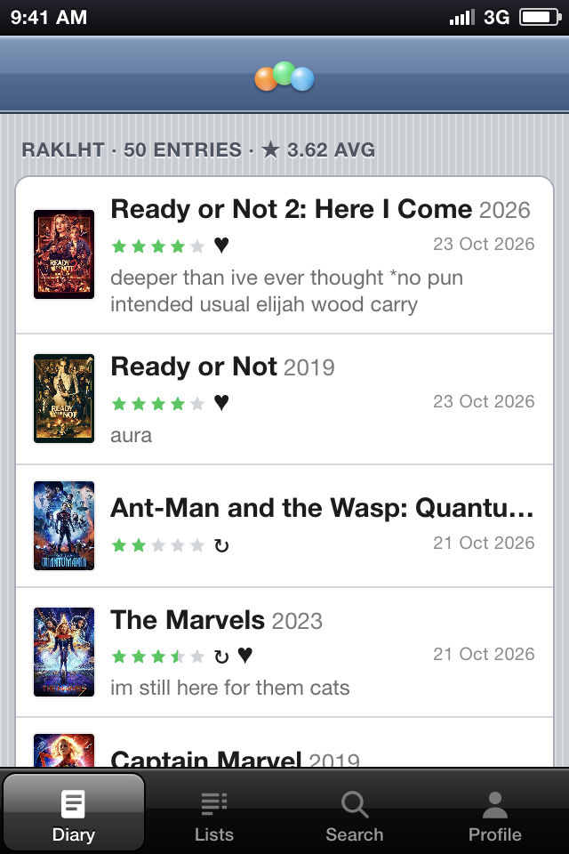
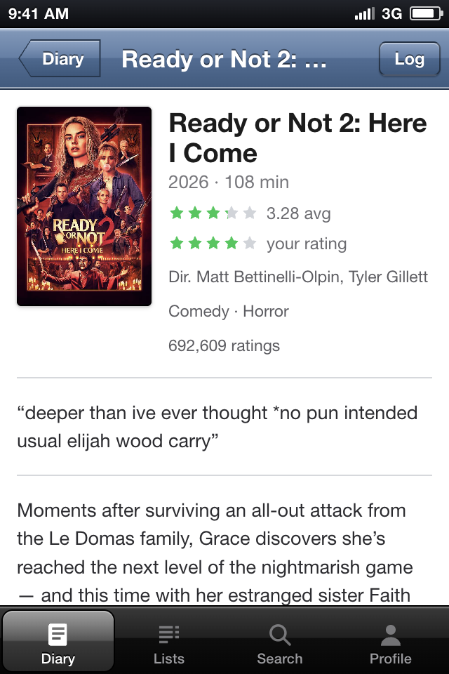
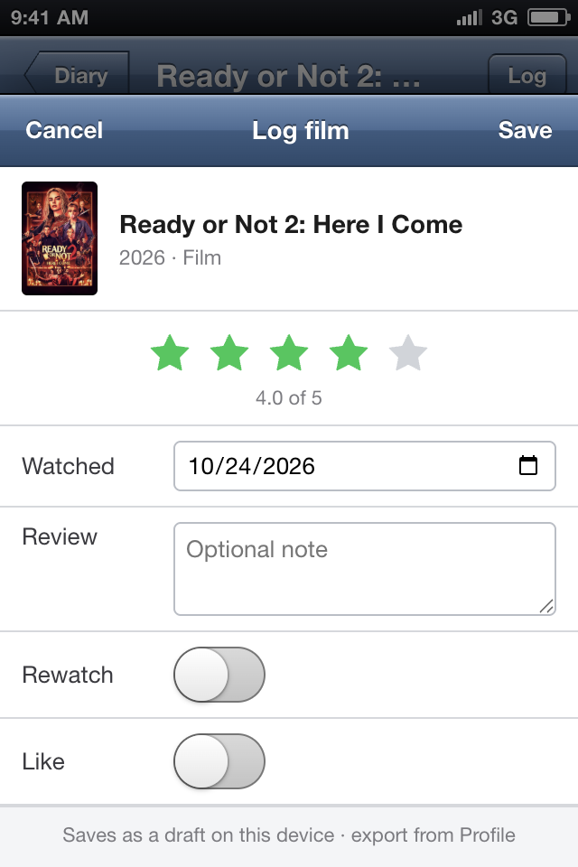
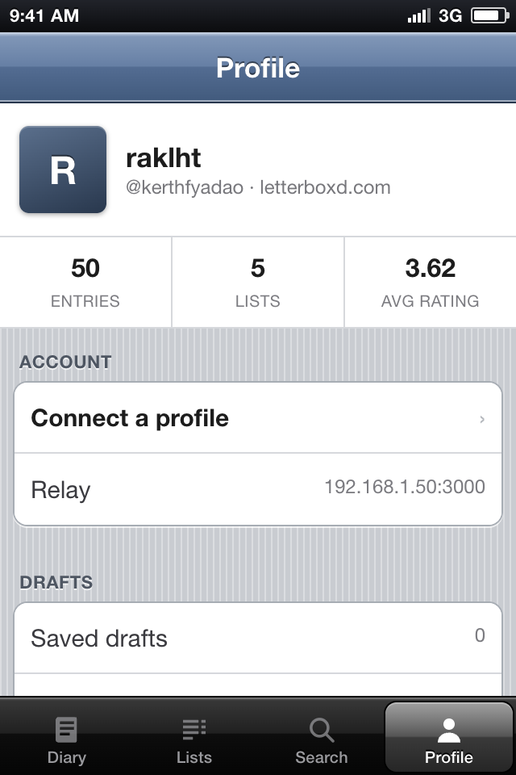

# Matinee

An iOS 6 Letterboxd client, built three ways:

- a **hand-written UIKit app** for iOS 6.1 / armv7 (Objective-C, ARC, no storyboards),
- a **browser mock** that renders the same screens in an iPhone 4S and iPad 2 frame, and
- a **small Node relay** that owns every request to Letterboxd and TMDB.

The phone never holds a Letterboxd password. It talks to the relay; the relay talks to the world.

<p align="center">
  
  
  
  
</p>

## Status

| Piece | State |
| --- | --- |
| Relay: diary, lists, film detail, image proxy, search, CSV/write shape | Working; 35 integration tests, live-tested against `letterboxd.com` |
| Browser mock: diary, film, log sheet, lists, search, profile, CSV | Working; 29/29 DOM tests |
| Installable mock: manifest, service worker, poster cache | Working; 4/4 service-worker tests |
| UIKit target: 4 tabs, diary, film, log, lists, search, profile | Compiled with Theos (armv7, min iOS 6.0) and packaged; **device run pending** |
| Direct log to Letterboxd | Form and transport tested against a local signed-in mock; a real cookie is still unverified |
| CSV → official Letterboxd import | Supported path |

The browser mock is the visual reference. The Objective-C target is the same design translated to UIKit. It now compiles and packages with Theos against the armv7 slice of the 11.4 SDK, with a 6.0 deployment target; the `.deb` is in `packaging/theos/packages/`. It has not been launched on a physical iOS 6 device yet, so treat that as the next test. `docs/GUIDE.md` explains the exact toolchain.

## Quick start

Requires **Node 18+**. The relay itself has no runtime dependencies; `jsdom` is only for the tests.

```bash
git clone https://github.com/YOURNAME/matinee.git
cd matinee
npm install
npm start
```

Open <http://127.0.0.1:3000>. You should see the iPhone and iPad previews and a live feed for `@kerthfyadao`.

```bash
npm test              # relay, mocks, DOM, write shape, ObjC, package
npm test -- --live    # also fetch letterboxd.com
```

The live suite is opt-in because it depends on the network and on Letterboxd's HTML remaining recognizable.

## Configuration

Copy the example once and put local secrets there:

```bash
cp .env.example .env
# edit .env, then:
npm start
```

`npm start` loads `.env` automatically, and `.env` is gitignored. Values already in the real environment win, so `TMDB_API_KEY=... npm start` works for a one-off override. If you run `node relay/server.js` directly, source the file first with `set -a; . ./.env; set +a`.

| Variable | Default | Purpose |
| --- | --- | --- |
| `PORT` | `3000` | HTTP port for the relay and mock |
| `MATINEE_MEMBER` | `kerthfyadao` | Public handle used when the app has no saved one |
| `TMDB_API_KEY` | unset | Enables search; without it the app shows an explanatory note |
| `LB_SESSION_COOKIE` | unset | Enables the experimental `POST /api/log` write path |

`LB_SESSION_COOKIE` is a real letterboxd.com session cookie. Keep it on the relay; never put it in the app, a screenshot, or git. See `docs/GUIDE.md` for the trade-offs.

## How it fits together

```
┌──────────────────────────┐        JSON over HTTP        ┌──────────────────────────┐
│  iPhone (UIKit, iOS 6)   │ ───────────────────────────► │   relay (Node, no deps)  │
│  MTDiary / MTFilm / ...  │ ◄─────────────────────────── │   /api/feed /api/film    │
└──────────────────────────┘                              │   /api/search /api/log   │
                                                          │   /img (allowlisted)     │
┌──────────────────────────┐        same endpoints        │                          │
│  Browser mock (jsdom-    │ ───────────────────────────► │                          │
│  tested static UI)       │ ◄─────────────────────────── │                          │
└──────────────────────────┘                              └───────────┬──────────────┘
                                                                      │
                                       ┌──────────────────────────────┼──────────────────────────────┐
                                       ▼                              ▼                              ▼
                              letterboxd.com RSS            letterboxd.com film pages         TMDB (optional)
                              (diary + lists)               (JSON-LD, form, CSRF)             (search only)
```

The relay is the security boundary. Its image proxy accepts only `https://a.ltrbxd.com` and `https://image.tmdb.org`, clamps the requested width to 80–900, and keeps a 64 MB / 300-entry byte cache. A hostile URL cannot turn the relay into a general-purpose fetcher.

## Project layout

```
matinee/
├── relay/
│   ├── server.js          HTTP routes, static mock, cache, CSV/write API
│   ├── lb.js              RSS + JSON-LD parsing, image URL rules, log form
│   ├── images.js          in-memory poster byte cache
│   └── fixtures/          captured feed/film pages for deterministic tests
├── web/
│   ├── index.html         iPhone + iPad preview page
│   ├── app.js             all mock screens and interactions
│   ├── style.css          iOS 6 chrome, back button, sheet, stars
│   ├── icon.svg           square app icon source
│   └── icon-*.png         home-screen / manifest icons
├── Matinee/
│   ├── Matinee.xcodeproj/ hand-written project file
│   └── Matinee/           15 Objective-C sources + Info.plist + icons
├── test/
│   ├── relay-api.js       offline HTTP routes, static files, SSRF boundary
│   ├── relay-search.js    TMDB search against a local HTTPS mock
│   ├── relay-write.js     signed-in form post against a local HTTPS mock
│   ├── dom-smoke.js       the original visual/interaction regressions
│   ├── dom-flows.js       search, lists, connect, iPad split view
│   ├── sw-cache.js        opaque poster caching without a browser
│   ├── write-shape.js     validates the log form shape
│   ├── objc-sanity.js     structure, imports, deployment target, banned APIs
│   ├── package.js         Theos, Info.plist, icons, screenshots, docs
│   ├── relay-live.js      live Letterboxd checks
│   └── run-all.js         the offline suite runner
├── docs/
│   ├── GUIDE.md           build, publish, tweak/Cydia, and write-path guide
│   └── screenshots/
├── packaging/theos/       Theos application scaffold for a .deb
├── .env.example
└── LICENSE
```

## The iOS app

Open `Matinee/Matinee.xcodeproj` in a toolchain that still has the iOS 6 SDK. The target is:

- iOS 6.0 deployment target, armv7,
- 100% Objective-C with ARC; no C files in the app target,
- no storyboards, no Auto Layout,
- `NSURLConnection`, `UIAlertView`, `sizeWithFont:constrainedToSize:lineBreakMode:`,
- custom-drawn chrome and stars (no image assets for UI),
- four tabs: Diary, Lists, Search, Profile.

**Toolchain:** Xcode 4.6.3 with the iOS 6.1 SDK is the clean option. Xcode 5.1.1 (with the iOS 6.1 simulator) can also build a 6.0 deployment target. Current Xcode cannot build 32-bit armv7, so a modern Mac needs a legacy VM or Theos. This tree builds with Theos and the 11.4 SDK's armv7 slice at a 6.0 deployment target; the resulting `.deb` is in `packaging/theos/packages/`. See `docs/GUIDE.md` for both routes.

On first launch, open **Profile → Change server** and enter the relay's LAN address, for example `http://192.168.1.50:3000`. The default in `MTStore.m` is a placeholder; change it before building or set it on the device. Then **Connect a profile** with a handle, profile URL, or RSS URL.

The app is not signed or notarized. Install it with Xcode to a jailbroken or provisioned device, or build the `.deb` in `packaging/theos/`.

## Rating and logging

There are two paths, and they are deliberately different:

1. **Drafts → CSV → Letterboxd import (supported).** Rate in the log sheet, save. Profile → **Export CSV** attaches `matinee-drafts.csv` to Mail, or copies it to the pasteboard when Mail is unavailable. Import at <https://letterboxd.com/import>. The CSV header is the official shape:

   ```text
   LetterboxdURI,tmdbID,imdbID,Title,Year,Directors,Rating,Rating10,WatchedDate,Rewatch,Tags,Review
   ```

   This needs no cookie, survives 2FA, and is the only path that has been verified end to end.

2. **Send to Letterboxd (experimental).** If the relay has `LB_SESSION_COOKIE`, the log sheet's **Send to Letterboxd** row posts the same form Letterboxd's own page posts, using the film page's CSRF token and `viewingableUid`. The form shape, signed-in detection, cookie forwarding, success, rejection, and expired-session paths are tested against a local HTTPS mock. A real member cookie was not available, so real-account acceptance is still unverified. It is off by default and returns `no_session` until configured.

Why not log in on the phone? It would mean handling a password, 2FA, cookie expiry, and CSRF on the device, and it would still be an unofficial write path. The relay keeps that blast radius on a machine you control, and the CSV path keeps the app useful without it.

Search needs a TMDB key. Without one, Search shows: “Search is powered by TMDB. Add TMDB_API_KEY to the relay to turn it on.”

## Design notes

- **The mark is the brand.** The Diary tab's navigation title is only the three-orb mark. No “Matinee” text competes with it.
- **A shaped back control.** The old `‹ Diary` text glyph was replaced with an iOS 6 pointed-cap button: a 1px outline, a vertical gradient, and a real tappable cap. The centered title shrinks to 46% on screens with a back button so the two never collide.
- **Stars are clipped per star.** Each star is its own path; the fill is clipped to `starWidth × fraction`, so the 2px gaps never count toward a half star. The color is `#00c853`.
- **The log sheet animates once.** `sheet-enter` is applied on mount only. A star tap repaints the same node in place (no table reload, no scroll jump), which is the behavior the DOM test guards.
- **Posters have a light placeholder.** `#e7e9ed`, not a dark gradient block, so a slow image reads as paper rather than a hole.
- **The icon is a full square.** iOS applies the rounded mask; baking the mask into the PNG would double-round it.

## Tests

```text
ok   relay-api:       20/20 passed
ok   relay-search:     7/7 passed
ok   relay-write:      8/8 passed
ok   dom-smoke:       15/15 passed
ok   dom-flows:       14/14 passed
ok   sw-cache:         4/4 passed
ok   write-path:      31/31 passed
ok   objc-sanity:     26/26 passed
ok   package:         15/15 passed
ok   relay-live:      17/17 passed   (opt-in; 50 diary, 5 lists, 50/50 posters)
```

The offline total is **140 assertions**. Search and direct write are exercised
against local self-signed HTTPS servers: the real request/parse/mapping code
runs. A configured TMDB key was also checked against the real API manually. A
real Letterboxd session cookie is still needed to prove the upstream account
accepts a post.

`objc-sanity` is structural, not a compiler; the Theos package build is the compile check. It checks that every source exists, every quoted import resolves, every `.m` is in the Sources phase, the deployment target and ARC settings are present, the four icon slots exist, and no iOS 7+ API token appears in the target.

## Publishing and Cydia

`docs/GUIDE.md` walks through:

- the build story, file by file,
- `git init` → GitHub → Pages,
- building the UIKit target with Xcode 4.6/5.1 or Theos,
- the difference between an **app package** and a **tweak**, with a Logos example and the legal caveats,
- a complete Cydia repo: `control`, `Packages`, `Release`, GitHub Pages, and the source URL to add in Cydia,
- the direct-write option and why CSV remains the supported path.

## Legal

Matinee is an unofficial client. It is not affiliated with Letterboxd or TMDB. Poster images and film metadata belong to their respective owners. The relay only reads public RSS and film pages; the optional write path uses the account owner's own session and is unsupported by Letterboxd. Respect Letterboxd's terms and do not hammer the site: the relay caches feeds for five minutes and posters for a day.

MIT licensed. See `LICENSE`.
