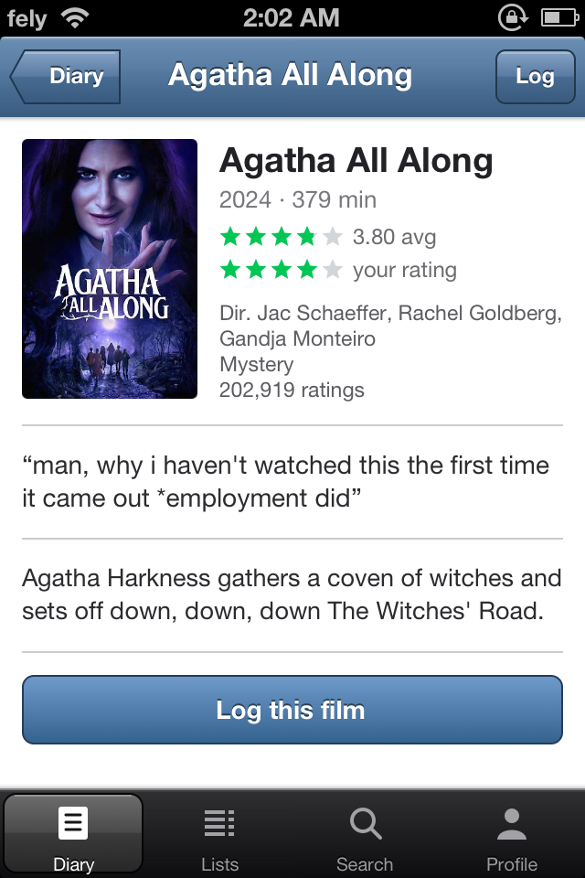

# Matinee

An iOS 6 Letterboxd client: cloudflare is making this hard so.. relay it is *still

The phone never holds a Letterboxd password. It talks to the relay; the relay owns the cookie and talks to Letterboxd and TMDB.

  
  
  
  

Search needs a TMDB key. Without one, Search shows: “Search is powered by TMDB. Add TMDB_API_KEY to the relay to turn it on.”

## Legal

Matinee is an unofficial client. It is not affiliated with Letterboxd or TMDB. Poster images and film metadata belong to their respective owners. The relay reads public RSS and film pages; the optional write path posts a diary entry with the account owner's own session and is unsupported by Letterboxd. Respect Letterboxd's terms and do not hammer the site: the relay caches feeds for five minutes and posters for a day.
