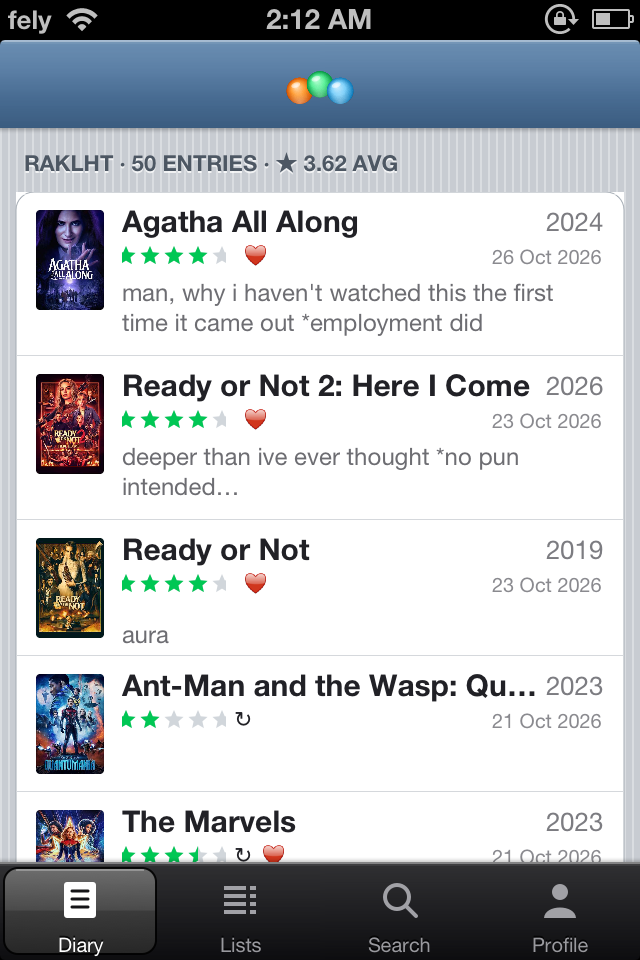
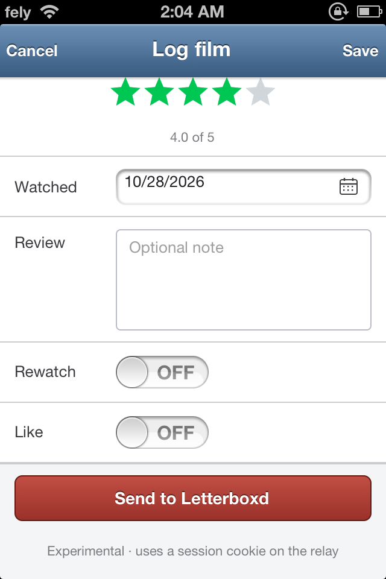
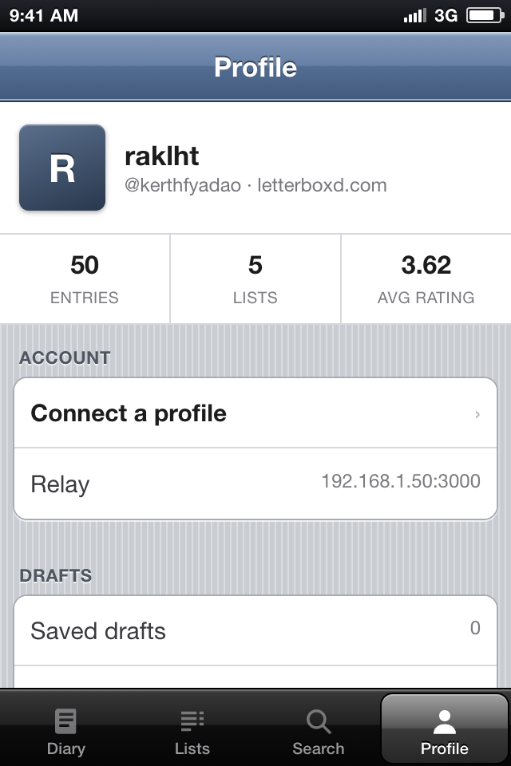

# Matinee

An iOS 6 Letterboxd client: cloudflare is making ts hard so.. relay it is

The phone never holds a Letterboxd password. It talks to the relay; the relay owns the cookie and talks to Letterboxd and TMDB.

<p align="center">
  
  
  
  
</p>


## Quick start

Requires **Node 18+**. The relay has no runtime dependencies.

```bash
git clone https://github.com/kerthmfy/Matinee-ios6.git
cd Matinee-ios6
npm install
npm start
```

The relay listens on <http://127.0.0.1:3000>. `GET /` returns a JSON endpoint index; `GET /api/health` reports the relay state. Point the app's **Profile → Relay** at the Mac's LAN address.

```bash
npm test              # cookie, relay, write shape, ObjC, package
npm test -- --live    # also fetch letterboxd.com
```

The live suite is opt-in because it depends on the network and on Letterboxd's HTML remaining recognizable.

## Configuration

Copy the example once and put local secrets there:

```bash
cp .env.example .env
# edit .env, then:
npm start
```

`npm start` loads `.env` automatically, and `.env` is gitignored. Values already in the real environment win, so `TMDB_API_KEY=... npm start` works for a one-off override. If you run `node relay/server.js` directly, source the file first with `set -a; . ./.env; set +a`.

| Variable | Default | Purpose |
| --- | --- | --- |
| `PORT` | `3000` | HTTP port for the relay |
| `MATINEE_MEMBER` | `kerthfyadao` | Public handle used when the app has no saved one |
| `TMDB_API_KEY` | unset | Enables search; without it the app shows an explanatory note |
| `LB_SESSION_COOKIE` | unset | Enables the experimental `POST /api/log` write path |
| `LB_USER_AGENT` | modern Chrome UA | Match the browser that produced `cf_clearance`; a mismatch can trigger a Cloudflare challenge |

`LB_SESSION_COOKIE` is a real letterboxd.com session cookie. Keep it on the relay; never put it in the app, a screenshot, or git. Cloudflare ties its clearance cookie to the browser that earned it, so also copy that browser's exact `User-Agent` into `LB_USER_AGENT`. See `docs/GUIDE.md` for the trade-offs.

### Capture a Letterboxd session

Letterboxd's sign-in page is behind Cloudflare, so the phone cannot log in. Sign in with a normal desktop browser first, then copy the **whole Cookie request header** into the relay. Letterboxd's session spans several cookies (`letterboxd.signed.in.as`, `letterboxd.user.CURRENT`), so the full header is more reliable than a single value.

1. In DevTools → **Network**, reload `https://letterboxd.com`, click the first document request, then **Headers → Request Headers → Cookie**. Copy the entire header value.
   - Alternative: Application/Storage → Cookies → `https://letterboxd.com`, then build `letterboxd.signed.in.as=<value>; letterboxd.user.CURRENT=<value>` by hand.
2. On the Mac running the relay:

   ```bash
   pbpaste | npm run cookie
   ```

The helper reads stdin (never argv), validates the session against `letterboxd.com/film/primer/` by checking `person.loggedIn`, writes `.env` with mode `0600`, and never prints the value. It refuses to replace a working cookie if validation fails. Options:

```bash
pbpaste | npm run cookie -- --force      # save even if validation fails
pbpaste | npm run cookie -- --no-verify  # skip the network check
```

Then copy the exact `User-Agent` request header from that same DevTools request into `.env`:

```bash
cat >> .env <<'EOF'
LB_USER_AGENT='Mozilla/5.0 (Macintosh; Intel Mac OS X 10_15_7) AppleWebKit/537.36 (KHTML, like Gecko) Chrome/156.0.0.0 Safari/537.36 Edg/156.0.4314.42'
EOF
```

Use your own browser's UA, not the example verbatim. Replace the line if `LB_USER_AGENT` is already present. Restart the relay, then tap **Profile → Check session** in the app, or:

```bash
curl -s http://127.0.0.1:3000/api/session
```

`/api/session` returns `{ ok, configured, signedIn, reason, slug, detail }`. `configured` only means the env value exists; `signedIn` means Letterboxd accepted it. Profile treats the endpoint as the source of truth and shows **Cookie valid**, **No cookie**, **Cookie expired**, **Relay offline**, or **LB unreachable**. **Check session** forces a fresh check after you restart the relay.

## How it fits together

```
┌──────────────────────────┐        JSON over HTTP        ┌──────────────────────────┐
│  iPhone (UIKit, iOS 6)   │ ───────────────────────────► │   relay (Node, no deps)  │
│  MTDiary / MTFilm / ...  │ ◄─────────────────────────── │   /api/feed /api/film    │
└──────────────────────────┘                              │   /api/search /api/log   │
                                                          │   /img (allowlisted)     │
                                                          └───────────┬──────────────┘
                                                                      │
                                       ┌──────────────────────────────┼──────────────────────────────┐
                                       ▼                              ▼                              ▼
                              letterboxd.com RSS            letterboxd.com film pages         TMDB (optional)
                              (diary + lists)               + first-party JSON (lid, CSRF)    (search only)
```

The relay is the security boundary. Its image proxy accepts only `https://a.ltrbxd.com` and `https://image.tmdb.org`, clamps the requested width to 80–900, and keeps a 64 MB / 300-entry byte cache. A hostile URL cannot turn the relay into a general-purpose fetcher.

## Project layout

```
matinee/
├── relay/
│   ├── server.js          HTTP routes, cache, CSV/write API
│   ├── lb.js              RSS + JSON-LD parsing, image URL rules, JSON write path
│   ├── cookie.js          validate and save a browser session into .env
│   ├── images.js          in-memory poster byte cache
│   └── fixtures/          captured feed/film pages for deterministic tests
├── Matinee/
│   ├── Matinee.xcodeproj/ hand-written project file
│   └── Matinee/           15 Objective-C sources + Info.plist + icons
├── test/
│   ├── cookie.js          cookie normalization, .env editing, permissions
│   ├── relay-api.js       offline HTTP routes, JSON index, SSRF boundary
│   ├── relay-search.js    TMDB search against a local HTTPS mock
│   ├── relay-write.js     signed-in JSON write and /api/session against a local HTTPS mock
│   ├── write-shape.js     validates the film JSON and log-entry shape
│   ├── objc-sanity.js     structure, imports, deployment target, banned APIs
│   ├── package.js         Theos, Info.plist, icons, screenshots, docs
│   ├── relay-live.js      live Letterboxd checks
│   └── run-all.js         the offline suite runner
├── docs/
│   ├── GUIDE.md           build, publish, tweak/Cydia, and write-path guide
│   └── screenshots/
├── packaging/theos/       Theos application scaffold for a .deb
├── .env.example
└── LICENSE
```

## The iOS app

Open `Matinee/Matinee.xcodeproj` in a toolchain that still has the iOS 6 SDK. The target is:

- iOS 6.0 deployment target, armv7,
- 100% Objective-C with ARC; no C files in the app target,
- no storyboards, no Auto Layout,
- `NSURLConnection`, `UIAlertView`, `sizeWithFont:constrainedToSize:lineBreakMode:`,
- custom-drawn chrome and stars (no image assets for UI),
- four tabs: Diary, Lists, Search, Profile.

**Toolchain:** Xcode 4.6.3 with the iOS 6.1 SDK is the clean option. Xcode 5.1.1 (with the iOS 6.1 simulator) can also build a 6.0 deployment target. Current Xcode cannot build 32-bit armv7, so a modern Mac needs a legacy VM or Theos. This tree builds with Theos and the 11.4 SDK's armv7 slice at a 6.0 deployment target; the resulting `.deb` is in `packaging/theos/packages/`. See `docs/GUIDE.md` for both routes.

On first launch, open **Profile → Relay** and enter the relay's LAN address, for example `http://192.168.1.50:3000`. The default in `MTStore.m` is a placeholder; change it before building or set it on the device. Then tap **Diary handle** and enter a public handle, profile URL, or RSS URL. This is the public feed handle, not a Letterboxd sign-in.


Search needs a TMDB key. Without one, Search shows: “Search is powered by TMDB. Add TMDB_API_KEY to the relay to turn it on.”


## Legal

Matinee is an unofficial client. It is not affiliated with Letterboxd or TMDB. Poster images and film metadata belong to their respective owners. The relay reads public RSS and film pages; the optional write path posts a diary entry with the account owner's own session and is unsupported by Letterboxd. Respect Letterboxd's terms and do not hammer the site: the relay caches feeds for five minutes and posters for a day.

MIT licensed. See `LICENSE`.
